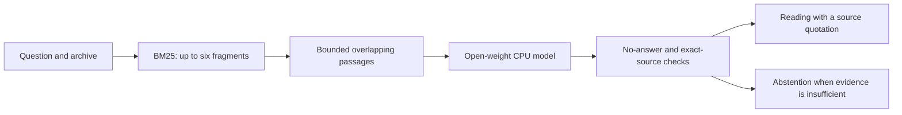

<!-- Publication note: this completed local article uses repository-relative links.
Before publishing on DEV, publish the code and demo, replace those links with their
real public URLs, and review the official Week 4 rules. No public entry is claimed.
-->

*This is a submission for the [Hacktoberfest Open-Source AI Challenge: Week 4 — Ghost in the Machine](https://dev.to/challenges/hacktoberfest-week4-2026-10-26).*

## What I Built

In an unsent letter, Nora explains why she leaves the sorting-room lamp on after closing. Once, someone looked for it from the last ferry. Later, a night nurse and a cinema cleaner began taking the road past her window. The light had become an invitation she could not know everyone was reading.

That fictional letter sits at the center of **Dead Letter Office**, an archive of things left unsaid. It holds letters, notes, photo descriptions and transcribed memories, then helps a reader ask factual questions about what remains. This is my interpretation of **Ghost in the Machine**: honor the past by keeping its words available, with a way back to their source.

The sample collection contains six fictional fragments from Bellwether post office. Readers can search them, follow a quotation back to the original page, or create a collection of their own. Collections export as JSON. A completed reading can also be saved as Markdown with its original question, source quotations, attribution, model and uncertainty intact.

The default AI works on an ordinary CPU with no API key. It selects existing words from the archive rather than inventing a new memory or speaking as a person. If it cannot identify a sufficiently supported span, the app abstains. That still does not prove the answer is absent; it tells the reader where the model's evidence stops.

## Demo

[Watch the recorded walkthrough](media/dead-letter-office-demo.webm).

The walkthrough uses the fictional Bellwether collection: open a reading, inspect its source, ask the on-device model a factual question, and save the result. The interface labels the four prewritten sample readings **AUTHORED SAMPLE · NOT AI-GENERATED**. Actual CPU results are labeled **ON-DEVICE AI · EXTRACTIVE READING**.


To try it locally:

```sh
npm ci
npm run setup:model
npm start
```

Open `http://127.0.0.1:4173`, choose **On-device AI**, and ask a direct question. The one-time model download is about 85.7 MB. After setup, inference loads local files with remote model loading disabled.

## Code

[Source, setup and project map](../README.md) · [Tests](../test) · [MIT application license](../LICENSE).

The application uses Node.js, vanilla HTML/CSS/JavaScript, Transformers.js and ONNX Runtime. It needs no database, GPU or separate model service. The source includes the model-download manifest, request and evidence checks, deterministic regression tests, and a separate command for real-model verification.

## How I Built It

The neural component is [deepset's tinyroberta-squad2](https://huggingface.co/deepset/tinyroberta-squad2), using the [onnx-community quantized ONNX conversion](https://huggingface.co/onnx-community/tinyroberta-squad2-ONNX). The model is published under **CC-BY-4.0**; attribution belongs to deepset and the ONNX conversion's community maintainers. The pinned quantized weights are used without fine-tuning. [Transformers.js](https://huggingface.co/docs/transformers.js) runs them on CPU in a worker thread.

The pipeline is small enough to inspect:



The model predicts an answer's start and end tokens. Because it was trained for SQuAD 2.0, it also has a no-answer output. The app compares the selected span with that output, maps the decoded words back to exact source characters, and shows a surrounding quotation. It independently checks the result before display. The span margin is a ranking signal, not a probability that a claim is true.

I kept the existing archive interface and retrieval approach, then completed the model setup, worker cancellation, source checks, import validation and error recovery. Canceling inference terminates the worker and discards its result; the next reading can start afresh. A failed model call never turns into a sample reading. The **Fragments considered** disclosure also makes retrieval's boundary visible instead of implying that the model read an entire collection.

The download script pins an immutable model revision, checks the weights' SHA-256 hash, and verifies tokenizer/configuration files before placing them in the runtime folder. API keys are unnecessary for this path. An optional hosted integration remains available, but it is not required for the demo and its real inference has not been verified here.

Validation separates deterministic unit/HTTP/browser checks from [actual model outputs and timings](verification.json). The latter can be reproduced with `npm run verify:local`. These are focused regression checks on fictional material, not a broad accuracy benchmark. Direct English factual questions fit this small model best. It can miss evidence, choose an irrelevant span, or abstain where a person could answer; checking the quotation remains part of the reading experience.

## Why Does Open Innovation Matter?

The key-free path became a concrete design requirement. Open weights let the application run real inference after a small, inspectable download, without a provider account or per-question API charge. Once the dependencies and model files are present, the archive does not need a hosted inference service to answer questions.

That matters for memories. In the default mode, a question and its fragments stay between the browser and the Node process on the same computer. The model has no tools that can send a message or run a command. Exported collections keep the original words portable, and saved readings preserve the evidence behind the model's selection.

Open source also makes the limitations visible. A contributor can inspect how retrieval chooses fragments, how the worker rejects an answer, and how quotations are checked. They can replace the model with another appropriately licensed component and evaluate that change without surrendering the archive to a service.

The tradeoffs are real: setup needs an initial download, CPU inference consumes local resources, the model is English-focused, and saved files are plaintext. Open weights do not remove those constraints. They make it possible to understand and change them.

## The Spirit of It

Nora's letter says, “I am not waiting for someone to come back. I want someone to know they can.” Dead Letter Office follows that idea: keep the small records, make them readable, and leave the source within reach.

*AI disclosure: Codex assisted with implementation, verification and this write-up. The author confirmed that the project was created during the Week 4 entry window.*

<!-- Publication checklist: publish the repository and recorded demo; convert the
relative code/media links above to verified public URLs; retain hf26challenge and
devchallenge tags and the AI disclosure; publish one entry by October 31, 2026,
11:59 PM PDT. The project does not claim any optional partner prize category.
-->
